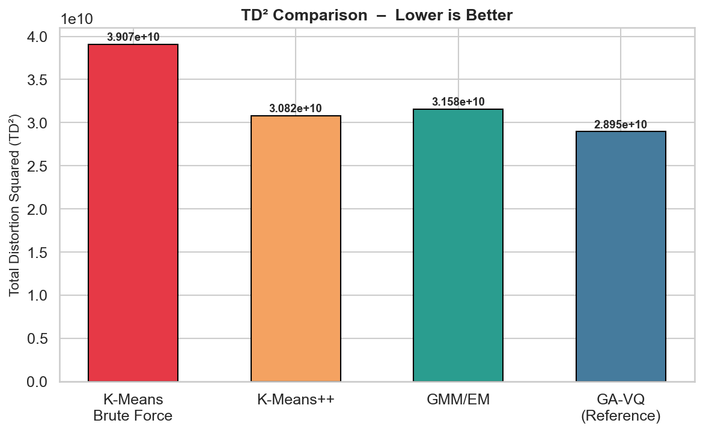
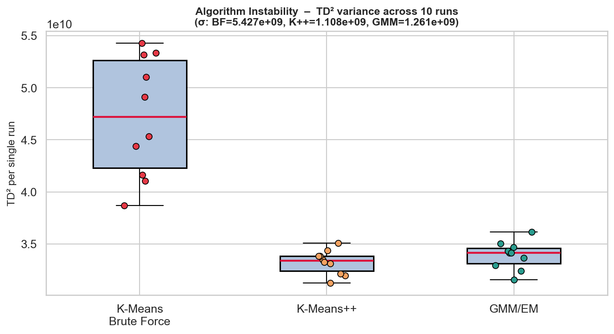
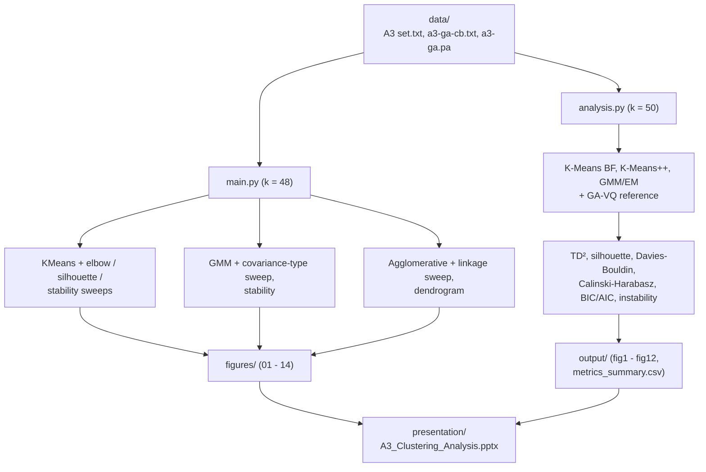

<p align="center">
  
</p>

<p align="center">
  
  
  
  
</p>

Unsupervised clustering of the A3 benchmark dataset (7,500 two-dimensional points in 50 Gaussian clusters) with K-Means, Gaussian Mixture Models and agglomerative clustering. The methods are compared against a genetic-algorithm reference solution using TD² (total squared distance), silhouette score, BIC/AIC and run-to-run stability, and the results are summarised in a presentation deck.

| | |
|---|---|
| **Context** | {{University, course (semester/year)}} |
| **Period** | {{e.g. Sep 2025 - Oct 2025}} |
| **Team** | Group of 3 |
| **Data** | [A3 benchmark](https://cs.uef.fi/sipu/datasets/) (Fränti & Virmajoki, 2006) plus the GA-VQ codebook and partition provided for the task |
| **Tech** | Python, scikit-learn, SciPy, pandas, matplotlib, seaborn |

📖 **[Full methodology, metrics and model-selection results → documentation.md](documentation.md)**

## Results at a glance

<p align="center">
  
  
</p>

K-Means++ and GMM/EM end up within about 6% and 9% of the GA-VQ reference solution's TD², with almost identical silhouette scores (0.594 and 0.590). K-Means with random initialisation, even with 50 restarts, is about 35% above the reference, and its TD² varies about five times more between single runs than that of K-Means++. On this dataset the initialisation matters more than the choice between K-Means and GMM.

| Algorithm | TD² | vs. GA-VQ | Silhouette | σ(TD²) over 10 runs |
|---|---|---|---|---|
| K-Means, random init (50 restarts) | 3.907e10 | +35% | 0.544 | 5.43e9 |
| K-Means++ (20 restarts) | 3.082e10 | +6% | 0.594 | 1.11e9 |
| GMM / EM (full covariance) | 3.158e10 | +9% | 0.590 | 1.26e9 |
| GA-VQ (reference) | 2.895e10 | n/a | 0.604 | n/a |

## Architecture



## Project structure

```text
a3-clustering-analysis/
├── main.py                  # sklearn comparison at k = 48, sweeps and stability (writes figures/)
├── analysis.py              # four-way comparison at k = 50 incl. GA-VQ reference (writes output/)
├── requirements.txt
├── documentation.md         # methodology, metrics and results in detail
├── data/
│   ├── A3 set.txt           # 7,500 points (x, y)
│   ├── a3-ga-cb.txt         # GA-VQ codebook (50 centroids)
│   └── a3-ga.pa             # GA-VQ partition (7,500 labels)
├── figures/                 # 01 - 14 plots produced by main.py
├── output/                  # fig1 - fig12 and metrics_summary.csv produced by analysis.py
├── presentation/
│   └── A3_Clustering_Analysis.pptx
└── assets/
    └── brand-banner.svg
```

## Outputs

- `figures/01_kmeans_clusters.png` … `14_agg_linkage_metrics.png` — cluster plots, elbow, TD² and silhouette sweeps, stability (ARI) and linkage comparison, from `main.py`
- `output/fig1_raw_data.png` … `fig12_comparison_grid.png` — the four-way comparison with the GA-VQ reference, from `analysis.py`
- `output/metrics_summary.csv` — all metrics per algorithm
- `presentation/A3_Clustering_Analysis.pptx` — the group's presentation deck (16 slides)

## Running it

```bash
python -m venv .venv
source .venv/bin/activate          # Windows: .venv\Scripts\activate
pip install -r requirements.txt
python analysis.py                 # about 20 s, writes output/
python main.py                     # about 2 min, writes figures/
```

`main.py` opens each plot in a window via `plt.show()`, so close the windows as they appear, or run it with `MPLBACKEND=Agg python main.py` to skip them. Both scripts resolve their paths relative to their own location, so they run from a clone in any location.

## Methodology

Cluster quality is judged with several measures: TD² for compactness, silhouette, Davies-Bouldin and Calinski-Harabasz for separation, BIC/AIC for the GMM, and the spread of TD² (and adjusted Rand index in `main.py`) across random seeds for stability. The GA-VQ solution that was provided with the task serves as the reference. Note that the two scripts use different settings: `analysis.py` uses the true k = 50, restarts and a 2,000-point sample for the silhouette, while `main.py` uses k = 48, single fits and the full dataset, so their absolute numbers are not directly comparable (details in [documentation.md](documentation.md)).

## Dataset and references

- P. Fränti and O. Virmajoki, "Iterative shrinking method for clustering problems", *Pattern Recognition* 39(5), 2006 (source of the A3 dataset)
- I. Kärkkäinen and P. Fränti, "Dynamic local search algorithm for the clustering problem", Report A-2002-6, University of Joensuu, 2002 (task paper, not included in this repository)
