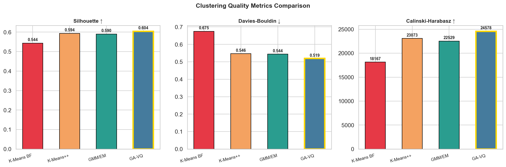
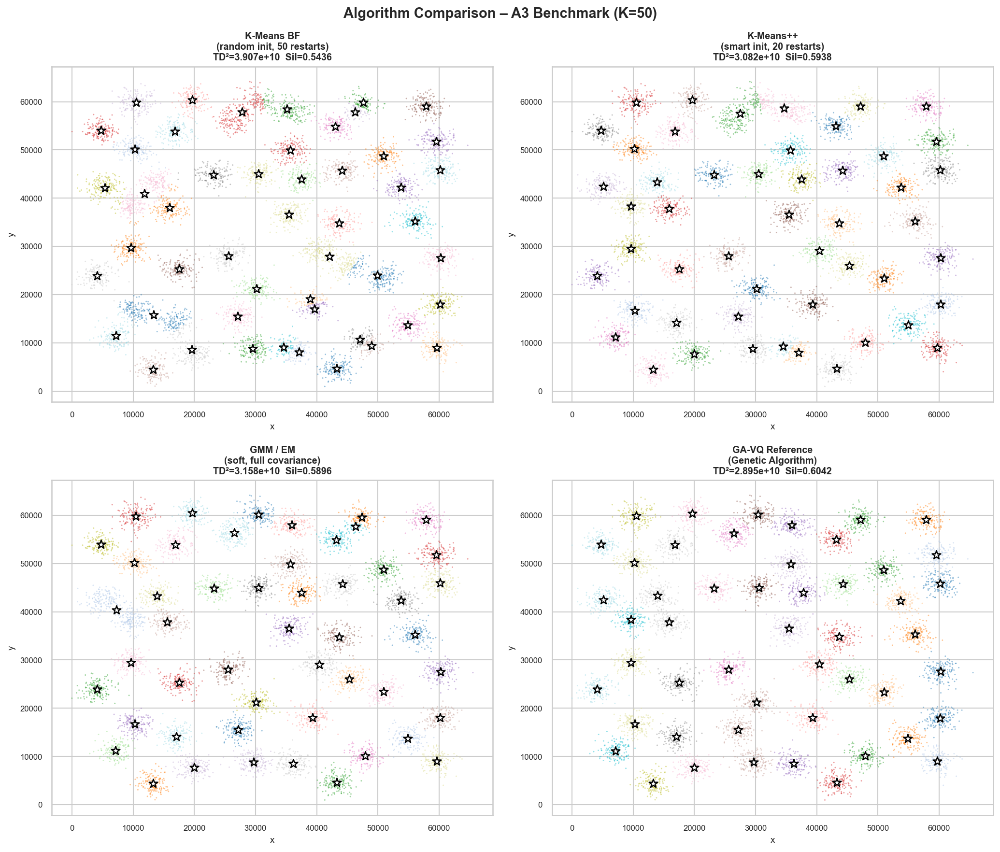
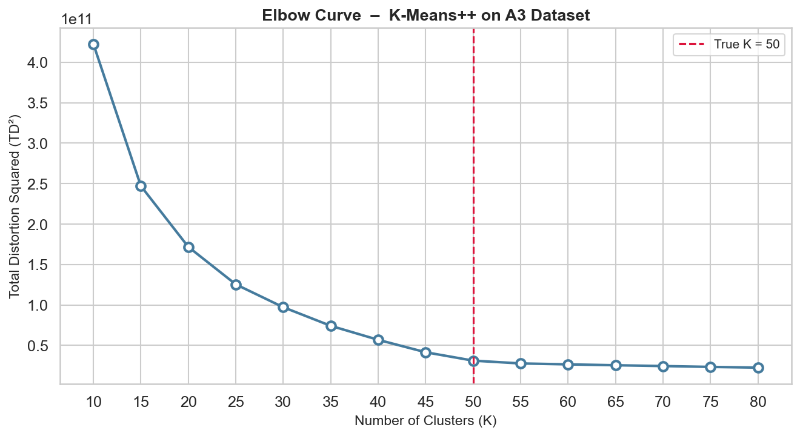
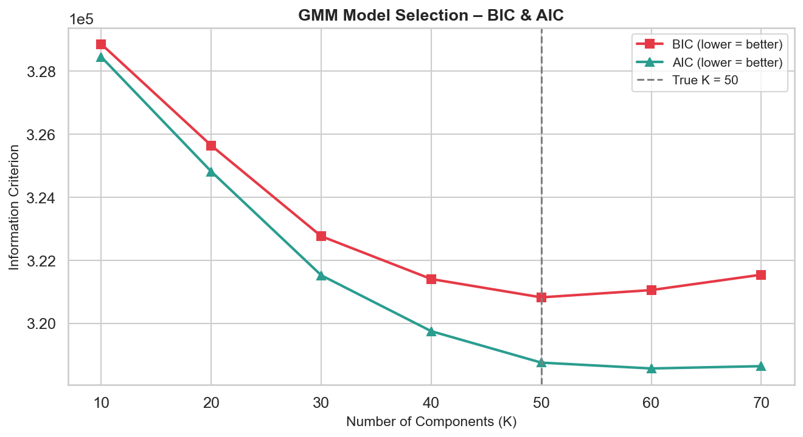
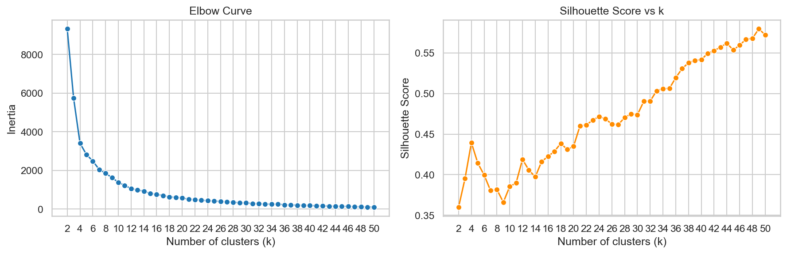
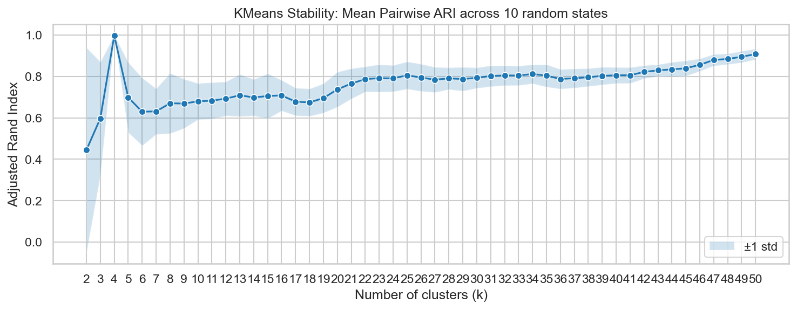
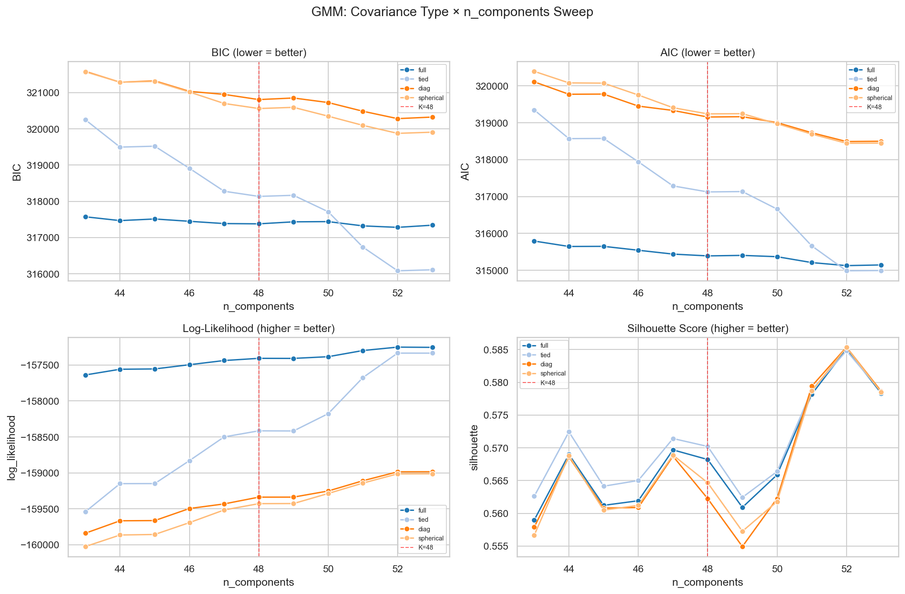
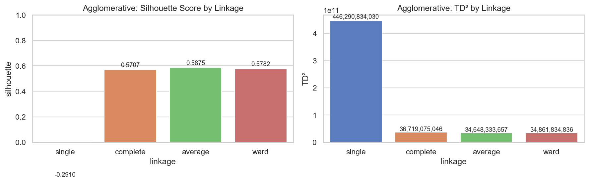

# Documentation: Clustering analysis of the A3 dataset

This document describes the data, the two analysis scripts, the metrics and the full results. The [README](README.md) gives the short version.

## Contents

1. [Data](#1-data)
2. [Algorithms](#2-algorithms)
3. [Metrics](#3-metrics)
4. [Four-way comparison (analysis.py, k = 50)](#4-four-way-comparison-analysispy-k--50)
5. [Model selection: elbow and BIC/AIC](#5-model-selection-elbow-and-bicaic)
6. [Sweeps and stability (main.py, k = 48)](#6-sweeps-and-stability-mainpy-k--48)
7. [Conclusions](#7-conclusions)
8. [Caveats](#8-caveats)
9. [Implementation notes](#9-implementation-notes)

## 1. Data

| File | Content |
|---|---|
| `data/A3 set.txt` | A3 benchmark: 7,500 two-dimensional points in 50 Gaussian clusters of varying density, coordinates roughly between 3,000 and 65,000 on both axes |
| `data/a3-ga-cb.txt` | Codebook of the genetic-algorithm vector quantisation (GA-VQ) solution: 50 centroids |
| `data/a3-ga.pa` | Partition of the GA-VQ solution: a cluster label for each of the 7,500 points |

The A3 dataset is a standard benchmark for vector quantisation and comes from Fränti and Virmajoki (2006). The number of clusters is known (50), which makes it possible to check model-selection methods against the truth. The GA-VQ files were provided with the task and are used as a reference, not re-run.

## 2. Algorithms

| Algorithm | Type | Setup in `analysis.py` |
|---|---|---|
| K-Means, brute force | hard assignment, uniform random initial centroids | 50 restarts, best run kept, max 300 iterations |
| K-Means++ | hard assignment, D²-weighted initial centroids | 20 restarts |
| GMM / EM | soft assignment, full covariance, optimises log-likelihood | 5 EM initialisations |
| GA-VQ | genetic algorithm, provided as reference | codebook and partition read from the files |
| Agglomerative (`main.py` only) | hierarchical, single / complete / average / ward linkage | k = 48 |

## 3. Metrics

- **TD²** = Σ ‖xᵢ − c(i)‖², the total squared distance of all points to their cluster centroid (identical to K-Means inertia). Lower means more compact clusters. For the GMM it is computed from the component means and the hard assignment.
- **Silhouette** (higher is better, range -1 to 1), **Davies-Bouldin** (lower is better) and **Calinski-Harabasz** (higher is better) measure separation and cohesion without needing the true labels.
- **Log-likelihood, BIC and AIC** exist only for the GMM, because it is a probabilistic model. TD² and log-likelihood measure different things, so a GMM does not have to win on TD².
- **Instability** is the standard deviation of TD² over 10 single-restart runs with different seeds.
- **Adjusted Rand index (ARI)** between clusterings from different seeds measures how reproducible the cluster assignments are (1 = identical).

## 4. Four-way comparison (analysis.py, k = 50)

| Algorithm | TD² | vs. GA-VQ | Log-lik. | Silhouette | Davies-Bouldin | Calinski-Harabasz | σ(TD²) | Time (s) |
|---|---|---|---|---|---|---|---|---|
| K-Means, random init | 3.907e10 | +34.9% | n/a | 0.544 | 0.675 | 18,167 | 5.43e9 | 2.08 |
| K-Means++ | 3.082e10 | +6.4% | n/a | 0.594 | 0.546 | 23,073 | 1.11e9 | 0.21 |
| GMM / EM | 3.158e10 | +9.1% | -159,026 | 0.590 | 0.544 | 22,529 | 1.26e9 | 0.78 |
| GA-VQ (reference) | 2.895e10 | n/a | n/a | 0.604 | 0.519 | 24,578 | n/a | n/a |

GMM: BIC 320,720 and AIC 318,650 at k = 50. The full table is in `output/metrics_summary.csv`.

  
  

  
  

- GA-VQ has the best value on every metric, as expected from a global-search reference.
- K-Means++ is closest to the reference on TD², silhouette and Davies-Bouldin, and GMM/EM is a close second. The GMM optimises likelihood instead of TD², so a slightly higher TD² is not surprising.
- Random-initialisation K-Means is clearly the worst and the least stable: its σ(TD²) is about 4.9 times that of K-Means++ and 4.3 times that of the GMM. Even the best of 50 restarts stays 35% above the reference.
- K-Means++ is also much faster than the brute-force version because it needs far fewer restarts.

## 5. Model selection: elbow and BIC/AIC

  
  

- **Elbow:** TD² of K-Means++ is computed for k = 10 to 80 in steps of 5. Up to k = 50 each step of 5 clusters lowers TD² by at least 22% (for example 4.16e10 at k = 45 to 3.12e10 at k = 50). Beyond k = 50 the gains shrink to 11% (50 to 55) and then to about 4% per step, so the knee sits at the true k = 50.
- **BIC/AIC** (full-covariance GMM, k = 10 to 70 in steps of 10, 3 initialisations):

| k | BIC | AIC |
|---|---|---|
| 10 | 3.2886e5 | 3.2845e5 |
| 20 | 3.2564e5 | 3.2482e5 |
| 30 | 3.2277e5 | 3.2153e5 |
| 40 | 3.2141e5 | 3.1975e5 |
| **50** | **3.2083e5** | 3.1876e5 |
| 60 | 3.2106e5 | **3.1857e5** |
| 70 | 3.2155e5 | 3.1864e5 |

BIC has its minimum at k = 50, the true number of clusters. AIC penalises complexity less and is lowest at k = 60 on this grid. The grid is coarse, so this shows the tendency, not an exact optimum.

## 6. Sweeps and stability (main.py, k = 48)

`main.py` fits each model once with `random_state = 42` and sweeps over k, covariance type and linkage. The values below therefore describe single fits.

| Model (k = 48) | Silhouette | TD² |
|---|---|---|
| K-Means (random init, 1 run) | 0.534 | 4.51e10 |
| GMM (full covariance) | 0.568 | 3.73e10 |
| Agglomerative (ward) | 0.578 | 3.49e10 |

**Agglomerative linkage (k = 48):**

| Linkage | Silhouette | TD² |
|---|---|---|
| single | -0.291 | 4.46e11 |
| complete | 0.571 | 3.67e10 |
| average | 0.588 | 3.46e10 |
| ward | 0.578 | 3.49e10 |

Single linkage fails on this dataset because it chains neighbouring clusters together. Average and ward linkage give the best partitions.

**K-Means stability (mean pairwise ARI over 10 seeds, standardised data):** 0.68 at k = 10, 0.79 at k = 30, 0.84 at k = 45, 0.88 at k = 48 and 0.91 at k = 50. Results become more reproducible as k approaches the true number of clusters.

**GMM stability (mean ARI over 5 seeds, k = 48):** full 0.890, tied 0.886, diag 0.881, spherical 0.877. The covariance type has little effect on reproducibility.

**GMM covariance sweep (n_components = 43 to 53):** the lowest BIC in this sweep is reached by the tied covariance type at 52 components (about 316,081), ahead of full (about 317,279). The silhouette score peaks near 52 components for all four covariance types (about 0.585).

  
  

  
  

## 7. Conclusions

- **K-Means++ is the practical default**: it is near the GA-VQ reference on compactness, stable across seeds and fast.
- **GMM/EM is a good alternative** when probabilistic memberships or elliptical clusters matter, and it has BIC/AIC for model selection.
- **Random-init K-Means is the weakest and least stable** method here, even with many restarts.
- **Initialisation matters more than the algorithm family** on this dataset: the gap between random init and K-Means++ is far larger than the gap between K-Means++ and GMM.
- **The true k = 50 is supported** by BIC and by the flattening elbow, while AIC prefers somewhat more components.

## 8. Caveats

- `analysis.py` computes silhouette scores on a random subsample of 2,000 points (the full silhouette is O(n²)), so those values are estimates. `main.py` uses all 7,500 points.
- The two scripts use different settings (k = 50 with restarts vs. k = 48 with single fits), so tables from section 4 and section 6 must not be compared directly. For example, a single random-init K-Means fit gives TD² = 4.51e10, while the best of 50 restarts gives 3.91e10.
- Stability is measured with 10 seeds (K-Means) and 5 seeds (GMM), which is small, and the BIC/AIC grids are coarse.
- The A3 data are synthetic Gaussian clusters. Real data with non-Gaussian or overlapping structure can rank the methods differently.
- Results can vary slightly across scikit-learn versions even with fixed seeds.

## 9. Implementation notes

| Step | Where | Library |
|---|---|---|
| Load data and GA-VQ reference | top of `main.py` / section 1 of `analysis.py` | pandas, NumPy |
| K-Means, GMM, agglomerative fits | `KMeans`, `GaussianMixture`, `AgglomerativeClustering` | scikit-learn |
| Dendrogram (300-point sample, complete linkage) | `linkage`, `dendrogram` | SciPy |
| Metrics | `silhouette_score`, `davies_bouldin_score`, `calinski_harabasz_score`, `adjusted_rand_score`, `bic`, `aic` | scikit-learn |
| Plots | `figures/` (main.py) and `output/` (analysis.py) | matplotlib, seaborn |

The presentation deck in `presentation/` is a static file and is not generated by the scripts in this repository.
